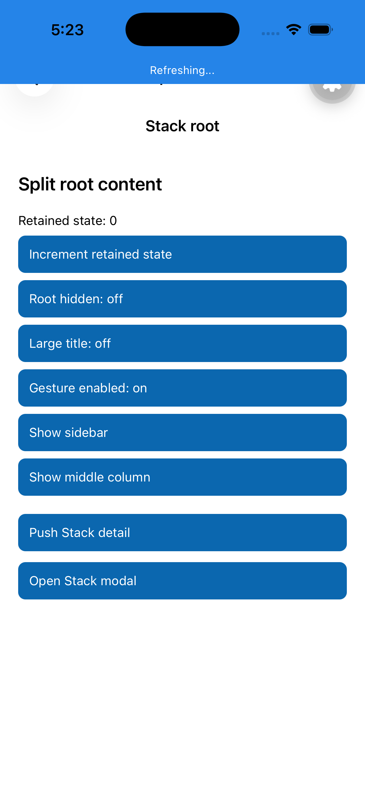
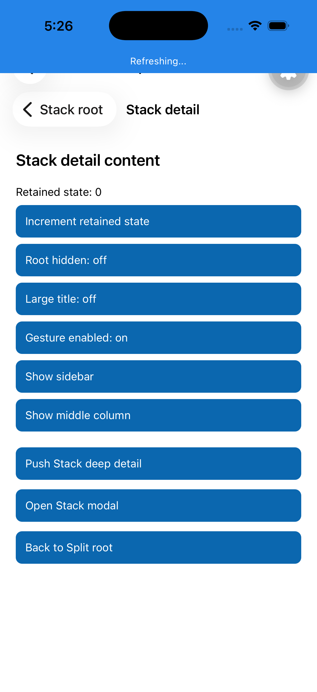
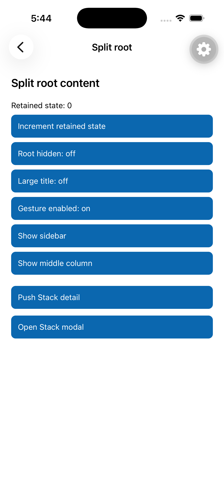
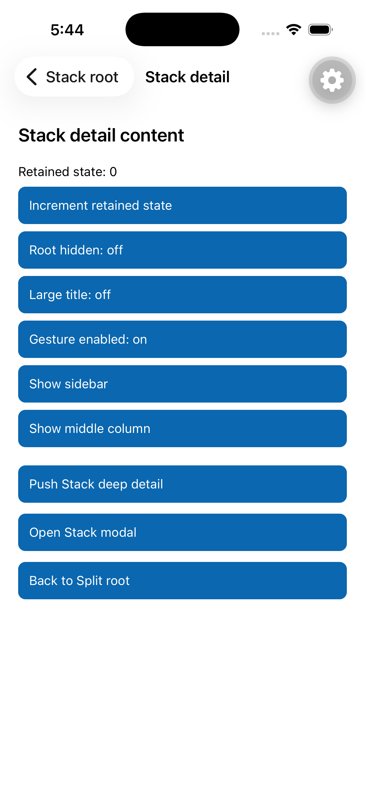
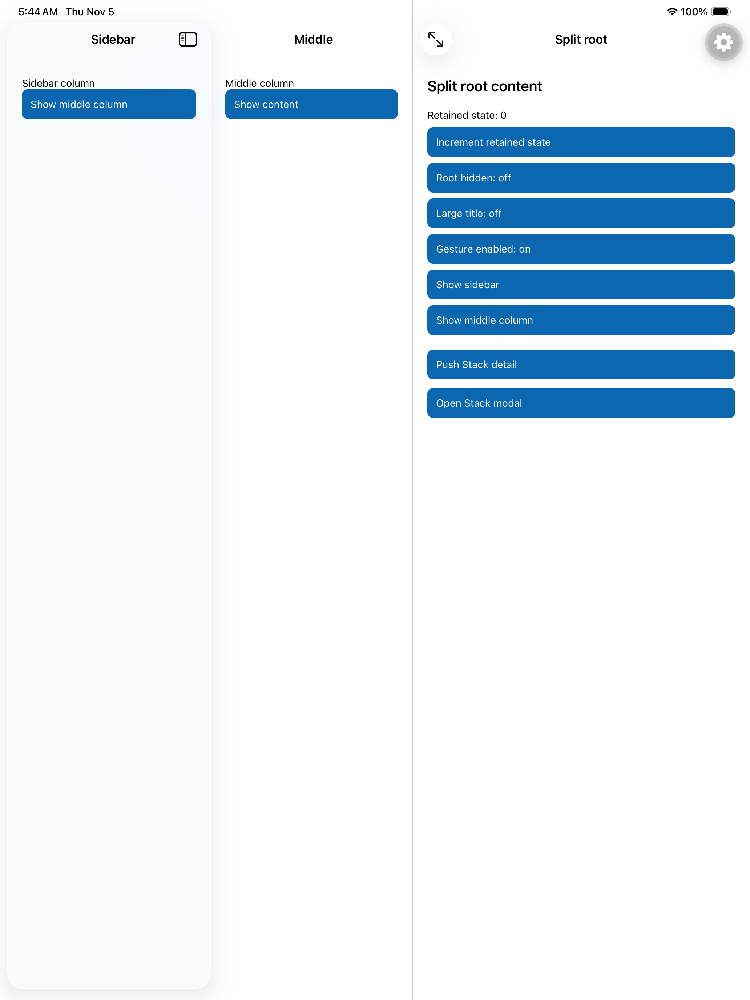
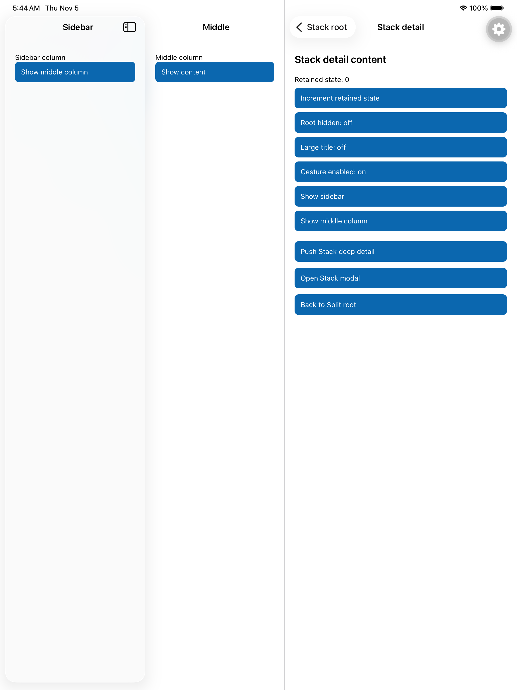
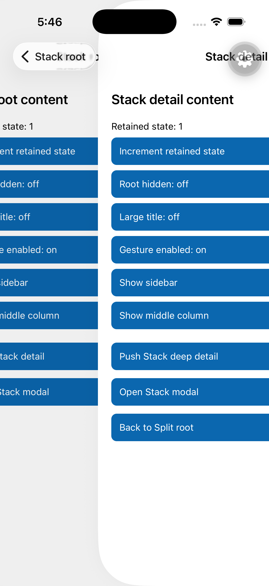

# Stack headers inside SplitView

Base: `test/pr-52564-header-gesture`, `b590a9984e7051a030c3a67b6b76f7225c0b6ebb`.
Ticket: https://linear.app/expo/issue/ENG-28808/router-integrate-stack-with-splitview

## Intended behavior

- At a settled Stack root, show the configured SplitView header.
- Before pushing from root, prepare and show the Stack root header and hide the SplitView header.
- Keep the Stack header throughout navigation animations and on pushed screens.
- Restore the SplitView header only after a completed pop reaches root. A cancelled pop keeps the Stack header.

The split and Stack keep separate navigation histories. SplitView header options are independent of Stack screen options; no navigation items or toolbar views are copied between them.

## Reproduction

Use the Router Tester home entry **Split View Stack Swizzle**, or open `router-tester://split-view-stack-swizzle`.
The root has a deliberately enabled Stack header titled **Stack root**, distinct from **Split root**. No JavaScript `headerShown` workaround is used.

The demo includes two pushes, a modal, column navigation, a retained counter, and toggles for split-header visibility, large title, and Stack gestures.

## Local setup

Run `pnpm install --frozen-lockfile`, then `pnpm prebuild --platform ios --no-install` in `apps/router-tester`.
Install pods with `EXPO_USE_PRECOMPILED_MODULES=0 pod install` and build the `RouterTester` workspace/scheme.
Use a separate Metro port for an isolated worktree; this run uses `8098`.

For native tests in this smaller app instead of bare-expo, add these declarations before `use_expo_modules!` in its generated, ignored Podfile:

```ruby
pod 'ExpoRouter', :path => '../../../packages/expo-router/ios', :testspecs => ['Tests']
pod 'ExpoModulesTestCore', :path => '../../../packages/expo-modules-test-core/ios'
```

Reinstall pods and run the generated `ExpoRouter-Unit-Tests` scheme with `CODE_SIGNING_ALLOWED=NO` and `OTHER_LDFLAGS='$(inherited) -lc++'`.
The C++ flag is needed by the standalone test bundle. The normal app builds without this override.

## Baseline evidence

- `et check-packages expo-router`: passed. 476 Jest suites, 6,149 tests, 257 snapshots; 9 skipped tests. Existing `no-void` lint warning in `useScreens.test.web.tsx`.
- Three new native tests fail with ten visibility assertions on the unchanged native implementation.
- iPhone 17 Pro, iOS 26.5: duplicate split and Stack headers at both root and pushed screen.





## Implementation

128 added lines in the existing native header view. Three scoped swizzles intercept Screens header configuration, controller-list updates before a root push, and completed navigation transitions. The existing split-column appearance hook handles column navigation. A top-column check prevents hidden columns from changing the shared collapsed navigation bar.

The hooks apply only to a Screens navigation controller directly contained by a split column. Ordinary stacks and stacks nested deeper inside screens keep their existing headers. This uses Screens Objective-C implementation selectors, so a Screens upgrade requires rerunning the native tests.

## Final verification

- Full router package checks passed: 476 Jest suites, 6,149 tests, 257 snapshots; 9 skipped tests.
- Full native suite passed: 46 tests across 11 suites on iOS 26.5. Five new cases cover root/push/pop ownership, late mounting/prop updates, stack isolation, offscreen columns, and animated handoff including cancellation.
- The timing test checks that the Stack root header is prepared before UIKit's push callback, stays visible during pop, survives cancellation, and yields to the split header after completion.
- Final Router Tester simulator build succeeded.
- iPhone 17 Pro: root, two pushes, button back, held interactive pop, cancelled pop, completed swipe-back, modal presentation/dismissal, hidden-root header, and column back/return passed. Retained state survived these transitions.
- iPad Pro 13-inch (M5): expanded three-column root, two pushes, and back-to-root passed. Sidebar and middle headers remained visible while the content column switched headers.
- Demo formatting and `git diff --check` passed. Whole-app TypeScript checking has existing `/404` typed-route errors outside this demo.

### Open spike limitations

Enabling the split large-title option still renders a small title in the nested-Stack demo. The title-mode code is unchanged from the base, but this has not been compared on an identical baseline build, so it is not classified as pre-existing. Large-title expansion needs follow-up before production use.

Rotation/collapse transitions, rapid repeated navigation, all Stack presentation modes, and older iOS versions were not exhaustively tested. This spike demonstrates the requested header handoff rather than full support for every Stack option.

### Final screenshots

| Device | Root | Pushed |
| --- | --- | --- |
| iPhone |  |  |
| iPad |  |  |

The Stack header remains in control while an interactive pop is held:



