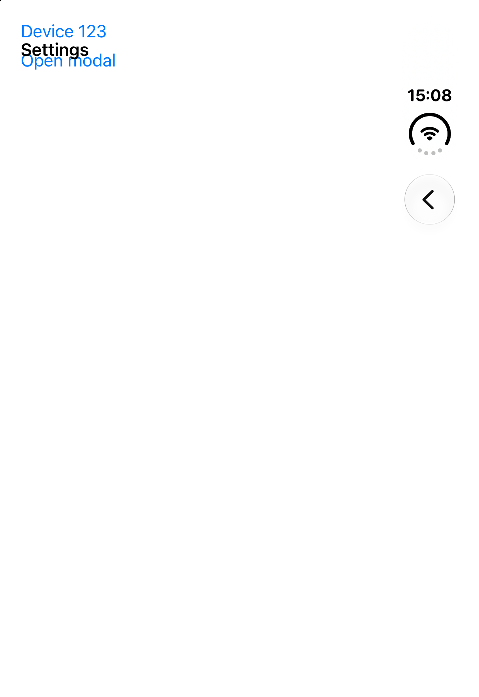

# Stack in SplitView — TODO

Issues found on the iPhone Duo simulator with `apps/router-tester`, demo `split-view-navigation`.

## 1. Content under the Stack header with automatic inset adjustment

**Steps:** Open `router-tester://split-view-navigation/settings` by deep link while the app shows another route.

**Observed:** One time, the `ScrollView` with `contentInsetAdjustmentBehavior="automatic"` got no top inset. The links showed under the "Settings" title. Two screenshots a few seconds apart showed the same layout. Later runs showed the content below the header.

**Expected:** The content always starts below the Stack header.

**Next step:** Find reliable steps to reproduce. Then check which navigation bar the scroll view uses for its inset while the split column bar is hidden.

## Known limitation: root swipe back uses a fade

**Steps:** Collapsed layout. Open Settings (nested Stack root). Swipe back to the previous column, or tap Back.

**Observed:** The split bar stays invisible during the pop and fades in after it, so the previous column header does not slide in with its screen. The rail Back does not follow the swipe: the previous column Back is hidden until the pop ends. Not checked on a Duo. After a Back tap, no header shows for about 0.3 s before the fade.

**Why:** UIKit draws a copy of the previous column title over the leaving Stack header when it animates the shared bar of the nested navigation controller. `SplitViewColumnView.hideSharedBarDuringPop` hides that bar until the pop ends.

The expanded sidebar button rule for `.twoDisplaceSecondary` is not verified on a device. The iPad Pro 13-inch never entered that display mode.
